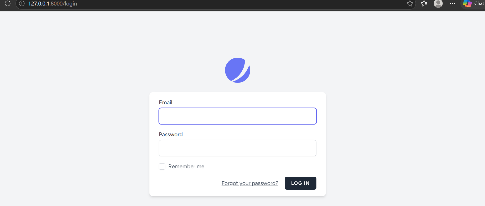
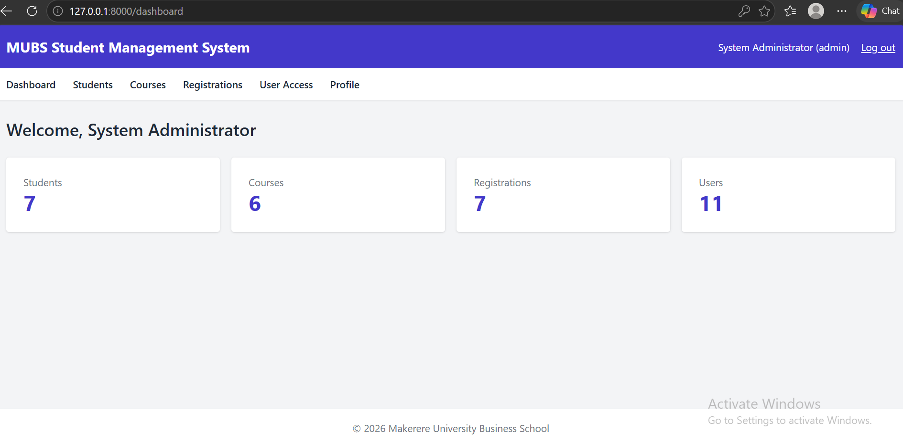
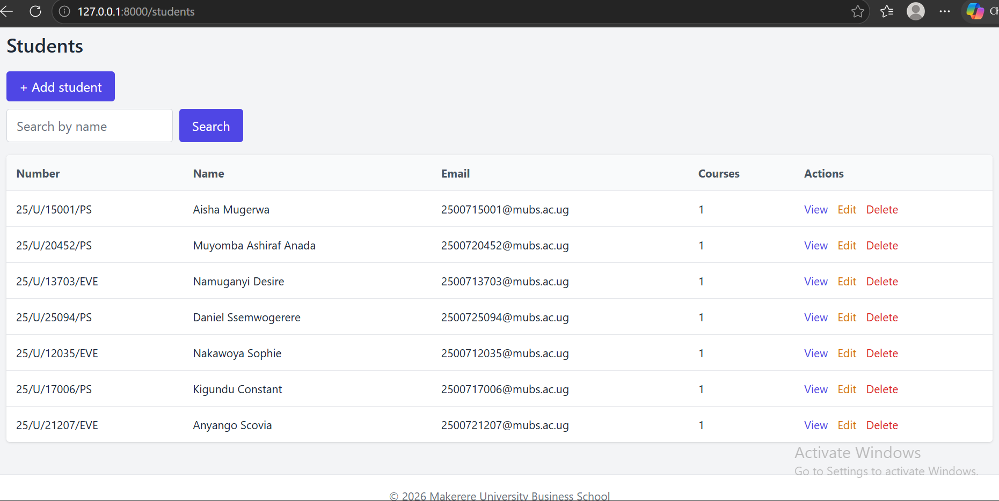
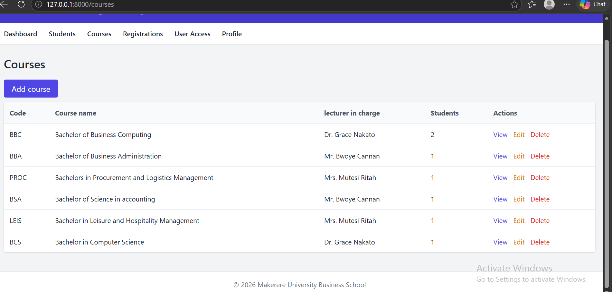
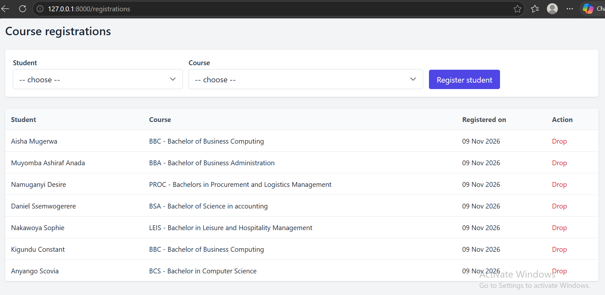
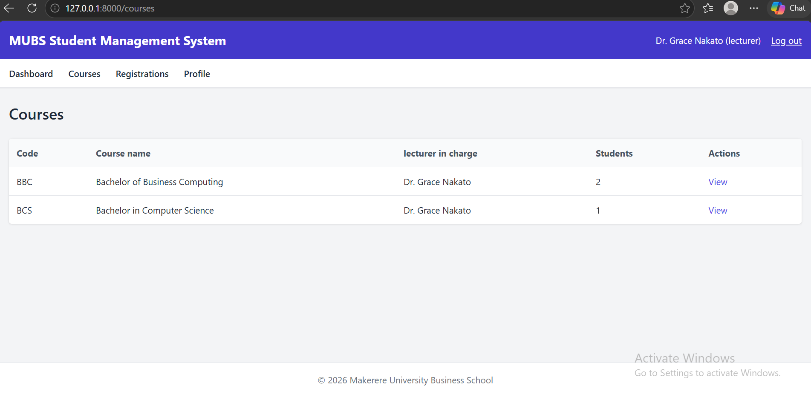
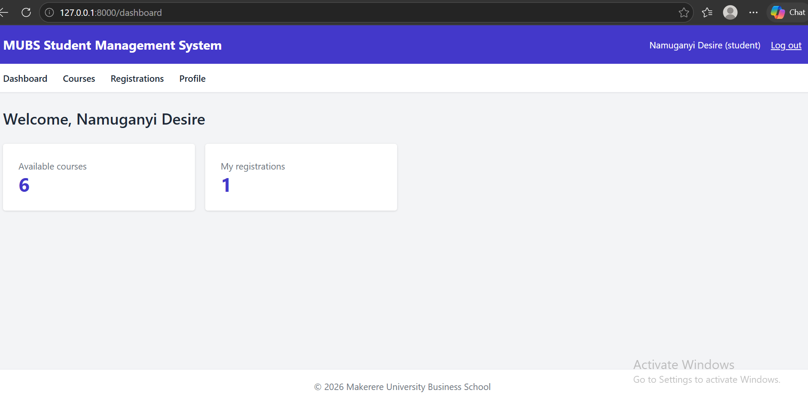
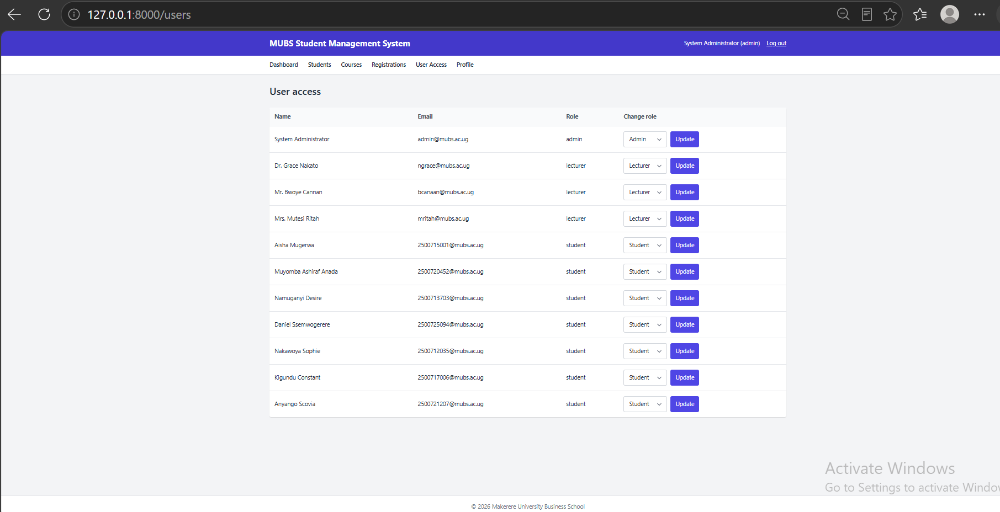

# MUBS Student Management System

BUC3131 Advanced Web Application Development, Coursework Two (2026/27). A group project built with Laravel and GitHub.

## About the project

A web system for managing students, courses, lecturers and course registrations. Administrators manage the records, lecturers see their own courses and the students registered in them, and students see the courses and their own registrations.

In this project a **course** is a degree course such as BBC (Bachelor of Business Computing), BBA or Procurement. A student registers into a course, and each course has a lecturer in charge. The database table is called `courses`, as in the coursework brief.

## Team

| Member | GitHub | Area |
|---|---|---|
| Nakyanzi Petra Ketra | petrahketra-tech | Project setup, authentication, roles and permissions, registration, documentation |
| Mutesi Joan | MJoan505 | Student CRUD, Blade layout, student search |
| Muyomba Ashiraf | 2400724311-ship-it | Database, relationships, seeders and sample data |

The contribution report in `docs/CONTRIBUTION_REPORT.md` lists the branches and pull requests of each member.

## Features

- Login, registration and profile pages (Laravel Jetstream)
- Three roles with permissions: admin, lecturer and student
- Admin: add, edit, view and delete students and courses, register students into courses, assign a lecturer to each course, and change user roles
- Lecturer: view only their assigned courses and the students registered in them
- Student: view courses, register into a course, and view or drop their own registrations
- Duplicate registrations are blocked by a check in the controller and by a unique index in the database
- Search students by name
- Success and error messages, form validation, and one reusable Blade layout with a header, navigation, content and footer
- Navigation links and buttons only show for users who have the permission

## Technology

Laravel, Laravel Jetstream (Livewire), Spatie laravel-permission, MySQL, Blade and Tailwind CSS.

## Requirements

PHP 8.2 or higher, Composer, Node.js with npm, and MySQL (for example through XAMPP).

## Installation

```bash
git clone https://github.com/petrahketra-tech/Student_Management_System.git
cd Student_Management_System
composer install
copy .env.example .env
php artisan key:generate
npm install
```

On macOS or Linux use `cp .env.example .env` instead of `copy`.

## Database setup

1. Start MySQL (in XAMPP, click Start next to MySQL).
2. Create an empty database named `studentms_db` in phpMyAdmin.
3. Open the `.env` file and set:

```
DB_CONNECTION=mysql
DB_HOST=127.0.0.1
DB_PORT=3306
DB_DATABASE=studentms_db
DB_USERNAME=root
DB_PASSWORD=
```

4. Create the tables and the sample data, then build the front end and start the server:

```bash
php artisan migrate:fresh --seed
npm run build
php artisan serve
```

5. Open http://127.0.0.1:8000 in the browser.

`migrate:fresh --seed` deletes all tables and creates them again with the sample data, so use it only on this project's database.

## Sample logins

The password for every sample account is the sample new password that we changed.

| Role | Email |
|---|---|
| Admin | admin@mubs.ac.ug |
| Lecturer | ngrace@mubs.ac.ug (Dr. Grace Nakato) |
| Lecturer | bcanaan@mubs.ac.ug (Mr. Bwoye Cannan) |
| Lecturer | mritah@mubs.ac.ug (Mrs. Mutesi Ritah) |
| Student |  2500713703@mubs.ac.ug (Muyomba Ashiraf)|

Seeded courses include BBC, BBA, PROC, BSA, LEIS and BCS, each with a lecturer in charge.

A new account created on the register page automatically becomes a student / has no role until an admin assigns one on the User Access page, kept the sentence that is true.

## Roles and permissions

| Role | Permissions | What they can do |
|---|---|---|
| admin | students.manage, courses.manage, registrations.manage, users.manage | Manage students, courses, registrations and user roles |
| lecturer | courses.view-assigned | View their own courses and the students registered in them |
| student | courses.view-available, registrations.view-own, registrations.create-own | View courses, register, and view or drop their own registrations |

Routes are protected with the `auth`, `role` and `permission` middleware in `routes/web.php`. The controllers also check ownership, so a lecturer cannot open another lecturer's course and a student cannot drop another student's registration (403 Forbidden).

## Database design

| Table | Main columns |
|---|---|
| users | name, email, password (Jetstream) plus roles from Spatie |
| students | user_id, student_number (unique), name, email (unique), phone |
| courses | code (unique), title, description, lecturer_id |
| course_registrations | student_id, course_id, with a unique pair (student_id, course_id) |

Relationships:

- A user (lecturer) has many courses, and a course belongs to one lecturer (`lecturer_id`)
- A user has one student record, and a student belongs to one user
- A student belongs to many courses and a course belongs to many students, through `course_registrations`
- `$student->courses` returns the courses of a student, and `$course->students` returns the students of a course
- Foreign keys use `constrained()`, and deleting a student or course removes their registrations (`cascadeOnDelete`)

## Main files

| Part | Location |
|---|---|
| Migrations | `database/migrations` |
| Models and relationships | `app/Models` |
| Seeders and sample data | `database/seeders` |
| Controllers | `app/Http/Controllers` |
| Routes and middleware | `routes/web.php` and `bootstrap/app.php` |
| Blade layout | `resources/views/components/sms-layout.blade.php` |
| Blade pages | `resources/views/students`, `courses`, `registrations`, `users` |

## Screenshots

Login page:



Admin dashboard:



Students list:



Courses list:



Course registrations:



Lecturer view:



Student view:



User access (roles):



## GitHub workflow

- `main` holds the stable code and `develop` is used for integration
- Each member worked on their own feature branch, for example `feature/database-and-seeders`, `feature/database-relationships` and `feature/crud-and-layouts`
- Changes were merged into `develop` through pull requests that another member reviewed and approved
- `develop` was tested with all three roles before it was merged into `main`

## Troubleshooting

| Problem | Fix |
|---|---|
| `vendor/autoload.php` not found | Run `composer install` |
| Page looks unstyled or Vite manifest error | Run `npm install` and `npm run build` |
| Could not connect to the database | Start MySQL, check `.env`, and create `studentms_db` |
| Target class [permission] does not exist | Check the middleware aliases in `bootstrap/app.php`, then run `php artisan optimize:clear` |
| There is no role named student | Run `php artisan migrate:fresh --seed` |
